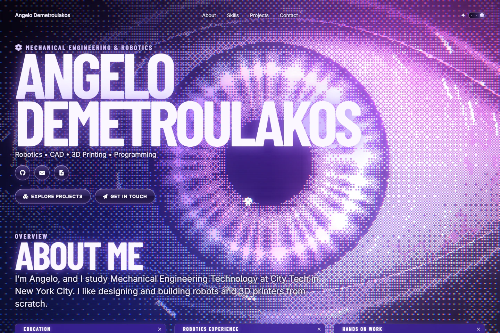
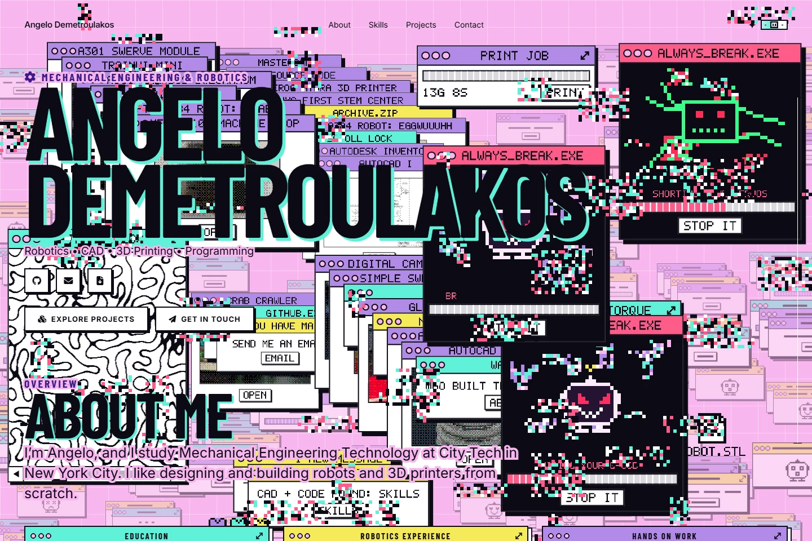

[](https://aloeveraz.github.io/)

<div align="center">

# Angelo Demetroulakos
**Mechanical Engineering & Robotics Portfolio**

Robots, mechanisms, and things I built from scratch — presented through glass, oversized type, and a living night sky.

[**Explore the portfolio ↗**](https://aloeveraz.github.io/)

</div>

## The look

Near-black backgrounds. Warm white lettering. Ice-blue accents. Barlow Condensed headlines paired with Inter body text. Translucent glass cards and a floating navigation bar catch the light over stars, planets, and black holes.

The site feels like a window into space, with the engineering work in the foreground.

| Detail | What gives it its character |
| --- | --- |
| **Glass & light** | Thin illuminated rims, frosted surfaces, and translucent buttons let the sky show through the interface. |
| **Scale & type** | Oversized condensed headings give the page its silhouette; quieter body text, small labels, and blue accents organize the details. |
| **Motion & depth** | The cosmic backdrop moves behind the page while cards respond to the cursor. Animated transitions connect the different looks. |
| **Images & space** | Large build photos sit inside a consistent card layout, with generous gaps between sections and compact tags for the technical details. |

The navigation's three-dot slider sets **Low, Medium, or High** effects, from left to right. Medium is the default: a living space scene with black holes, worlds, and comets. High adds richer activity, interactive orbs, fleets, and cursor effects; Low keeps a mostly still starfield. The page adapts to smaller screens and respects reduced-motion preferences.

## The work


I'm a Mechanical Engineering Technology student at City Tech in New York City. I design mechanisms, build robots and devices, and work through the CAD, fabrication, electronics, and programming that make them run. This portfolio brings the finished builds together with the experiments, revisions, and lessons behind them.

- **Robotics & mechanisms** — swerve drivetrains, FTC robots, odometry pods, and club builds.
- **Devices & fabrication** — a custom CoreXY printer, a digital camera, transit displays, and an animated electronic keychain.
- **The process behind them** — CAD, code, build photos, videos, and write-ups explaining the problem, method, and result.
- **Experience & learning** — City Tech coursework, NYC FIRST internships, research, awards, and technical skills.

The page moves from an introduction and About Me into Skills, Featured Projects, the project archive, and Contact. Featured cards open detailed project sheets over the page; archive folders group personal, work, club, research, and class projects into browsable collections. You can explore a build and return to where you left off.

## Alternate looks

The same portfolio has a different visual personality behind the star. **Click the star once, or press a slider stop twice quickly, to cycle through the looks available at that effects level.** These are the two main alternate styles:

### The eye · High effects



**Violet light · Pixel texture · Living anatomy**

A giant eye fills the background with moving iris fibres, lit veins, sparks, and a flowing aura. Visible dithering, separated color channels, and light bleeding across the image give it the feel of a glowing digital display. Purple glass controls and luminous lettering carry that palette into the portfolio itself.

The eye assembles from its internal structure before waking up. It blinks and eases between small glances and wider looks on its own. **Double-click the eye** to tint its iris and let it follow your cursor for ten seconds; then its resting color returns and it goes back to looking around.

*Try it: move the slider to High, then click the star.*

### The robot desktop · Medium effects



**Pastel pink · Pixel robots · A desktop coming apart**

Pink grid wallpaper sits behind a growing stack of lavender, teal, and hot-pink windows. Heavy black borders, hard offset shadows, pixel lettering, and blocky progress bars give the interface a late-90s desktop feel. The mischievous robot appears in glitching windows while digital static spills across the screen.

The windows are part of the portfolio: project and section links become desktop items, alongside a print job, infill control, and torque window. Drag windows around, minimize them to the bottom bar, or poke the robot. The familiar name and page sections remain underneath the disorder.

*Try it: move the slider to Medium, then click the star to cycle past the eye to the desktop.*

Alternate looks load only when selected. Reloading returns to the default look. The star briefly glints on arrival and occasionally while browsing to invite exploration.

## Behind the site

Built from scratch with **HTML, CSS, and JavaScript**, hosted directly on **GitHub Pages**. There is no framework, package installation, or production build step.

- **Structure:** `index.html` provides the page sections, navigation, and project-sheet shell. It includes initial text so the page can show useful content before the data loads.
- **Content:** `portfolio-data.json` holds the profile, headings, skills, collections, projects, and links. `portfolio.js` fetches it and builds the cards, galleries, project sheets, and other interactions.
- **Design:** `portfolio.css` defines the layout, typography, spacing, responsive rules, and transitions. `navbar.css` handles the floating navigation and effects slider; `glass.js` supplies the glass effects.
- **Backdrops:** `cosmos.js` draws the animated space scene. Separate scripts and styles provide the eye and retro desktop looks when discovered.
- **Assets:** WebP photos, smaller card images, fonts, and icons are served from the repository. Project videos use YouTube embeds when opened.

Content and presentation are kept separate: adding a build usually means adding its media and a project record, while the shared rendering code gives it the same card and sheet layout as the rest.

<details>
<summary><strong>Run locally or edit the portfolio</strong></summary>

From the repository root:

```bash
python -m http.server 8000
```

Open [localhost:8000](http://localhost:8000). A local server is needed to load the project data.

Edit `portfolio-data.json` for content; use `portfolio-template.json` for the format. Validate with:

```bash
python tools/check-data.py
```

See the [maintenance guide](docs/MAINTENANCE.md) for file roles, media tools, design tokens, caching, and content editing, or the [performance tools](tools/perf/README.md) for browser checks.

</details>
