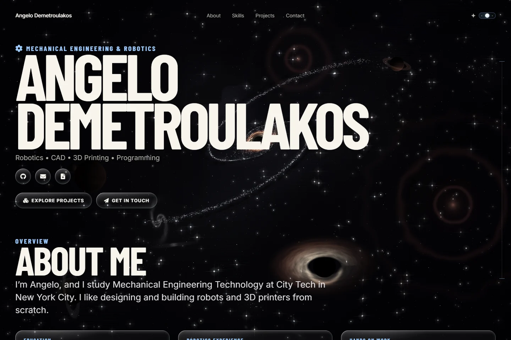
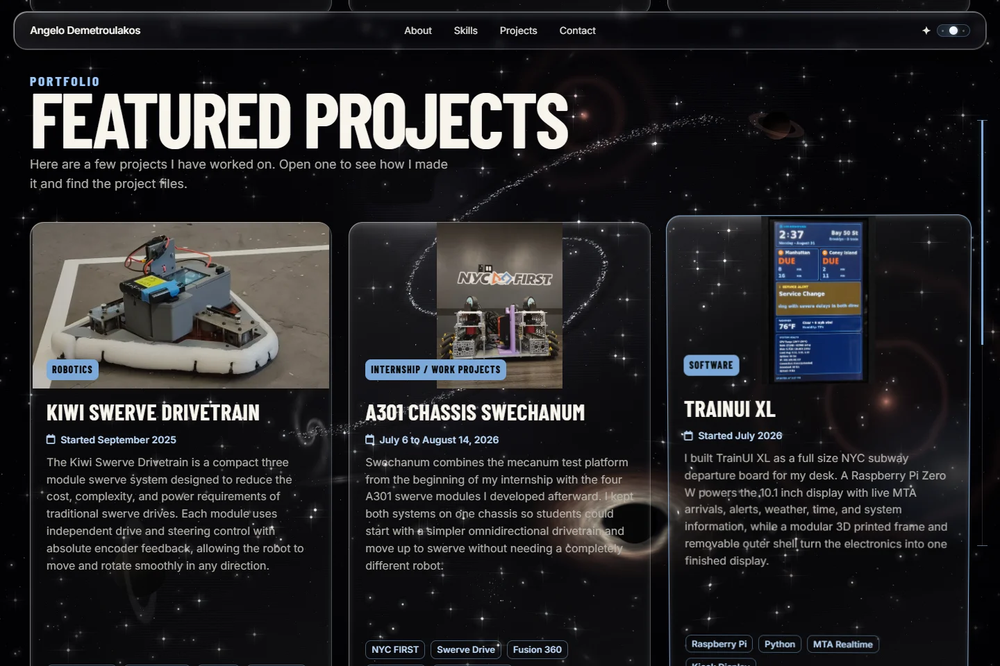

<div align="center">

# Angelo Demetroulakos
**Mechanical Engineering & Robotics Portfolio**

Robots, mechanisms, and things I built from scratch — presented through glass, oversized type, and a living night sky.

[**Explore the portfolio ↗**](https://aloeveraz.github.io/)

</div>

[](https://aloeveraz.github.io/)

## The look

Near-black backgrounds. Warm white lettering. Ice-blue accents. Barlow Condensed headlines paired with Inter body text. Translucent glass cards and a floating navigation bar catch the light over stars, planets, and black holes.

The site feels like a window into space, with the engineering work in the foreground.

| Detail | What you'll see |
| --- | --- |
| **Glass & light** | Frosted surfaces, illuminated edges, and buttons that react to the cursor |
| **Motion & depth** | An interactive cosmic backdrop, tilting cards, and animated transitions |
| **Three effects levels** | Low, Medium, and High, selected from the navigation bar |
| **Hidden looks** | Double-press a slider stop to discover eyes and, on Medium, a pink retro desktop |

## The work



- **Robotics & mechanisms** — swerve drivetrains, FTC robots, odometry pods, and club builds.
- **Devices & fabrication** — a custom CoreXY printer, a digital camera, transit displays, and an animated electronic keychain.
- **The process behind them** — CAD, code, build photos, videos, and project write-ups covering the problem, method, and result.
- **Experience & learning** — City Tech coursework, NYC FIRST internships, research, awards, and technical skills.

Featured cards open into detailed project sheets. The archive groups the rest into personal projects, work, clubs, research, and classes.

## How the page is laid out

The portfolio is one scrolling page, with a floating navigation bar linking its main sections. On smaller screens the links and effects control sit inside the navigation menu.

| Section | What happens there |
| --- | --- |
| **Introduction** | Large name and focus area, social and résumé links, and shortcuts to projects and contact |
| **About Me** | A short bio followed by cards for education, experience, and hands-on work |
| **Skills & Expertise** | Three groups: CAD and design, manufacturing and fabrication, and software and controls |
| **Featured Projects** | A selection of builds shown as photo-led cards; select one to open its project sheet |
| **My Projects** | Expandable collections for personal, work, club, research, and class projects, with browsable project rings |
| **Contact & Links** | Ways to get in touch and find the related repositories and project files |

Project sheets open over the page so you can explore a build without losing your place. Depending on the project, a sheet includes the problem, method, result, build steps, photos, video, and links to code or CAD. Close it to return to browsing.

## Effects & alternate looks

The three-stop slider beside the diamond in the navigation controls how much visual activity the site uses. **Left is Low, middle is Medium, right is High.** A visit starts at Medium; changes are remembered for that visit, and the site can step down if rendering becomes slow.

| Level | The space backdrop & interface | Alternate looks |
| --- | --- | --- |
| **Low** | A mostly still starfield with occasional twinkles and shooting stars, and simpler glass | A dithered eye with glossy Y2K-style windows |
| **Medium** | A moving space scene with black holes, worlds, comets, and landers, plus cursor-reactive cards | A GPU-drawn eye, then a pink retro desktop with a robot and project-linked pop-ups |
| **High** | A richer animated galaxy, interactive orbs, battling fleets, frosted glass, and custom cursor effects | A more detailed animated eye with fibres, veins, and sparks |

**Press a slider stop twice quickly, or click the diamond once, to cycle through that level's looks.** The eyes wake up and look around on their own, easing between small glances, occasional wider looks, and pauses toward the viewer. Double-click an eye to change its color and let it follow your cursor for ten seconds; it then returns to its resting color and stops tracking. The retro desktop uses the portfolio's own projects and links. Reloading returns to the default look. Alternate-look files load only when selected.

The diamond gives paired glints every few seconds during the opening ten seconds, then about once a minute to invite exploration. Using the control pauses the reminders for a minute. Hints stay quiet while a project is open, in a hidden tab, or when reduced motion is enabled.

The space backdrop dims after a few seconds without input and wakes when you interact again. Reduced-motion preferences also simplify transitions and motion.

## Behind the site

Built from scratch with **HTML, CSS, and JavaScript**, hosted directly on **GitHub Pages**. There is no framework, package installation, or production build step.

- **Structure:** `index.html` provides the page sections, navigation, and project-sheet shell. It includes initial text so the page can show useful content before the data loads.
- **Content:** `portfolio-data.json` holds the profile, headings, skills, collections, projects, and links. `portfolio.js` fetches it and builds the cards, galleries, project sheets, and other interactions.
- **Design:** `portfolio.css` defines the layout, typography, spacing, responsive rules, and transitions. `navbar.css` handles the floating navigation and effects slider; `glass.js` supplies the glass effects.
- **Backdrops:** `cosmos.js` draws the animated space scene. Separate scripts and styles provide the eye and retro desktop looks when discovered.
- **Assets:** WebP photos, smaller card images, fonts, and icons are served from the repository. Project videos use YouTube embeds when opened.

Content and presentation are kept separate: adding a build usually means adding its media and a project record, while the shared rendering code gives it the same card and sheet layout as the rest.

<details>
<summary><strong>Run locally or edit the portfolio</strong></summary>

From the repository root:

```bash
python -m http.server 8000
```

Open [localhost:8000](http://localhost:8000). A local server is needed to load the project data.

Edit `portfolio-data.json` for content; use `portfolio-template.json` for the format. Validate with:

```bash
python tools/check-data.py
```

See the [maintenance guide](docs/MAINTENANCE.md) for file roles, media tools, design tokens, caching, and content editing, or the [performance tools](tools/perf/README.md) for browser checks.

</details>
